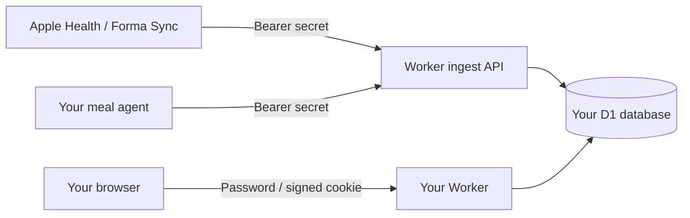

# Forma dashboard template

A private Apple Health and meal dashboard, served by one Cloudflare Worker with a D1 database in **your own account**. The interface is in Italian. The template contains no health records, meal history, account identifiers or deployed-site credentials.

## 1. What it stores

Only what you send: daily health quantities, workouts, sleep events, meal entries and daily summaries, optional body composition, and owner-supplied nutrition targets. D1 also holds dashboard caches and short-lived login failure counters (IP, time window, count). The embedded food composition table is a generic starter set of public reference values, not a meal plan; its supplement map is empty.

Health and meal data stay in your Cloudflare account. The application has no analytics, third-party data export or external fonts. Optional Access verification fetches Cloudflare's public signing certificates; it does not send health data. The dashboard requires a signed session cookie or configured Access identity. Data APIs never expose targets through public assets.



## 2. Prerequisites

- Your own Cloudflare account with Workers and D1 access.
- Node.js 20+ and npm; Node.js 22.13+ is recommended and required for the built-in SQLite test checks. Your installed Wrangler version may require a newer Node release.
- Git. Python is **not** needed to build, run or deploy the dashboard.

Clone or download this template, then enter its directory. There is no hosted shared service to sign up for. The commands below are for you to run on your machine; no deployment is performed by the build or tests.

## 3. Install and create the database

```sh
npm install
npx wrangler login
npx wrangler d1 create forma-health
cp wrangler.example.toml wrangler.toml
```

Copy the `database_id` printed by the create command into `wrangler.toml`. Edit:

- `name`: a Worker name you own, such as `forma-dashboard`.
- `database_name`: the database name you just created.
- `database_id`: that database's printed ID, replacing the placeholder.
- `[vars]`: optional settings described below. Start with the supplied UTC defaults.

Then create the empty schema in your database:

```sh
npm run db:migrate:remote
```

The migration contains no seed records. The default D1 binding is `DB`. If you rename the binding, set `D1_BINDING` to match and change `DB` in the migration scripts in `package.json`, or run `npx wrangler d1 migrations apply YOUR_BINDING --remote` directly.

`wrangler.toml`, local secrets, database state and build output are ignored by Git. Keep account-specific values out of the committed example file.

## 4. Set secrets

Generate separate strong values. For example, `openssl rand -base64 48` is suitable for `SESSION_KEY` and `INGEST_SECRET`. Store each value in your password manager, then enter it at the corresponding prompt:

```sh
npx wrangler secret put SITE_PASSWORD
npx wrangler secret put SESSION_KEY
npx wrangler secret put INGEST_SECRET
```

Use `wrangler secret put` for deployed secrets; never put them in TOML, source files or commits. Rotating `SITE_PASSWORD` or `SESSION_KEY` invalidates existing dashboard sessions. Missing either dashboard secret makes `/login` return 503 with “Accesso non configurato.” Missing `INGEST_SECRET` makes either ingest endpoint return 503 `{"error":"ingest_not_configured"}`. An incorrect or missing bearer returns 401. Sessions last 90 days; `/logout` clears the browser cookie. Login attempts are limited to ten failures per IP per fifteen-minute window.

## 5. Build and deploy

```sh
npm run deploy
```

This runs the deterministic Node build, embeds only the explicitly listed static assets into `build/worker.js`, then runs `wrangler deploy`. Your default site is:

```text
https://<name>.<your-subdomain>.workers.dev
```

For a custom domain, uncomment the **top-level** `routes` block in `wrangler.toml` and change `dash.example.com` to your domain. Its zone must belong to your account. Alternatively, add the domain through **Workers → Settings → Domains & Routes** in the dashboard. Deploy again after configuration changes; you do not need to edit or rebuild HTML to change `SITE_LABEL`.

## 6. Smoke test with synthetic data

Set `$SITE` to your actual origin and `$INGEST_SECRET` to your own secret in your local shell. Do not paste credentials into shared terminals, logs or screenshots. These commands use only explicitly synthetic data:

```sh
SITE=https://dash.example.com
# Set INGEST_SECRET privately in your shell or password manager integration.
curl --fail-with-body "$SITE/api/ingest/meals" \
  -H "Authorization: Bearer $INGEST_SECRET" -H 'Content-Type: application/json' \
  --data '{"source":"test","entries":[{"id":"synthetic-meal-a","day":"2040-01-01","meal":"pranzo","time":"12:00","title":"Synthetic meal A","kcal":500,"protein":20,"carbs":80,"fat":10}],"days":[{"day":"2040-01-01","day_type":"riposo"}]}'

curl --fail-with-body "$SITE/api/ingest/meals?day=2040-01-01" \
  -H "Authorization: Bearer $INGEST_SECRET"

curl --fail-with-body "$SITE/api/ingest/health" \
  -H "Authorization: Bearer $INGEST_SECRET" -H 'Content-Type: application/json' \
  --data '{"source":"test","format":"forma-sync/2","quantities":[{"type":"step_count","agg":"sum","date":"2040-01-01","value":10000,"unit":"count"}]}'

curl --fail-with-body -X DELETE "$SITE/api/ingest/health?source=test" \
  -H "Authorization: Bearer $INGEST_SECRET"
curl --fail-with-body -X DELETE "$SITE/api/ingest/meals?source=test" \
  -H "Authorization: Bearer $INGEST_SECRET"
# Alternatively, delete one diary day (including its daily summary):
curl --fail-with-body -X DELETE "$SITE/api/ingest/meals?day=2040-01-01" \
  -H "Authorization: Bearer $INGEST_SECRET"
```

Check that each write returns `ok: true`. Open your site, log in with `SITE_PASSWORD`, and verify the empty dashboard. `source: "test"` entries are deliberately hidden from the dashboard but readable through the meals API. The health cleanup deletes test rows from health and meal tables; the meals cleanup deletes only test meals and summaries. Neither removes global targets or supplement configuration from `kv`.

## 7. Connect Apple Health

### Forma Sync iOS app

Forma Sync is a separate project: build and install it separately, then grant the desired Apple Health read permissions. **Always explicitly set `url`**: the app's built-in default points to a different owner's deployment.

Paste this configuration into the app or scan it as a QR code, replacing the placeholders locally:

```json
{"url":"https://dash.example.com/api/ingest/health","client_id":"unused","client_secret":"unused","bearer":"<INGEST_SECRET>"}
```

The URL must be the full ingest endpoint ending in `/api/ingest/health`. Forma Sync requires non-empty `client_id` and `client_secret`, even in bearer-only mode: use `unused` for both. The Worker ignores their CF-Access headers unless optional Access is fully configured. With Access, use your actual service-token values instead. The app sends `Authorization: Bearer <bearer>` and supports `forma-sync/2` and `/1`.

Alternatively, use these KEY=VALUE lines:

```text
INGEST_URL=https://dash.example.com/api/ingest/health
CF_ACCESS_CLIENT_ID=unused
CF_ACCESS_CLIENT_SECRET=unused
INGEST_BEARER=<INGEST_SECRET>
```

`INGEST_BEARER` here is an **iOS app input key**; the Worker's secret is named `INGEST_SECRET`.

To make a QR code entirely locally, save the JSON to an ignored `config.json`, install `qrencode` separately, then run:

```sh
qrencode -o config.png < config.json
# After importing successfully:
rm config.json config.png
```

Both files contain credentials. Avoid cloud QR generators. Do not commit either file.

### Health Auto Export

Create a REST API automation with method POST, URL `https://dash.example.com/api/ingest/health`, `Content-Type: application/json` and `Authorization: Bearer <INGEST_SECRET>`. Choose the metrics and workouts you want to export. The Worker accepts its `{"data":{"metrics":[...],"workouts":[...]}}` shape and converts supported units. With Access enabled, also add the service-token headers.

### Apple Shortcuts

Create a daily personal automation. Use **Find Health Samples** for the selected day and calculate the relevant sums/averages. Use the day's local `yyyy-MM-dd` date; do not split a day by UTC unless that is your intention. Build a Dictionary and use **Get Contents of URL**, POST with JSON body and the same Authorization header:

```json
{"date":"2040-01-01","metrics":{"active_kcal":500,"resting_kcal":1500,"steps":10000,"exercise_min":30,"distance_km":5},"workouts":[]}
```

This is a synthetic shape example; populate it with samples from your own device. Missing metrics should be omitted, rather than fabricated as zero. Re-sending the same daily keys updates them. The Shortcut stores its bearer locally; restrict access to it.

## 8. API reference

Both ingest endpoints require `Authorization: Bearer <INGEST_SECRET>` for **every** method, including reads and deletes. A dashboard cookie does not grant ingest access. They optionally also require an Access service JWT as described below.

### Meals: `/api/ingest/meals`

POST a JSON object. All lists are optional:

```json
{
  "source":"test",
  "entries":[{
    "id":"synthetic-meal-a","day":"2040-01-01","meal":"pranzo","time":"12:00",
    "title":"Synthetic meal A","kcal":500,"protein":20,"carbs":80,"fat":10,
    "notes":"Synthetic fixture","items":[{"f":"banana","g":100}],"nutrients":{"fiber":10}
  }],
  "days":[{"day":"2040-01-01","day_type":"riposo","kcal":2000,"protein":100,"notes":"Synthetic summary"}],
  "targets":{"riposo":2000,"protein":[100,140]},
  "supp_plan":[]
}
```

For actual diary writes, omit `source: "test"`; the stored source is then `forma`. POST also accepts `?source=test`. Limits are 200 entries and 100 summaries per call. Successful writes return `{"ok":true,"written":...,"errors":[]}`. Partial validation failures return HTTP 200 with `ok:false` and field errors; valid entries may already have been written. Always inspect `ok` and read back your writes.

- `id` is the upsert key. Use a stable owner-chosen ID per entry; reusing it updates the row. If omitted, an ID is derived from day, meal and title, so explicit IDs are safer when editing titles.
- Dates use `YYYY-MM-DD`; time uses `HH:MM`. Meal keys: `colazione`, `spuntino`, `pranzo`, `merenda`, `cena`, `altro`, `giornata`. Unknown meal keys become `altro`.
- Summaries also accept `kcal_min`, `kcal_max`, `protein_min`, `protein_max`. `day_type` must be in `DAY_TYPES`; otherwise it is stored as null. Unknown configured types display their raw name.
- Macro quantities are kcal or grams. `items` may contain `{f:food_key,g:grams}`, `{s:supplement_key,n:units}` (or `g` for supplements measured in grams), or `{x:"unmapped food",why:"reason"}`. Generic keys are in `src/nutrition/foods.json`.
- Optional `nutrients` accepts `kcal, protein, carbs, fat, fiber, sugars, satfat, sodium, potassium, calcium, iron, magnesium, zinc, selenium, vitA, vitB1, vitB2, vitB3, vitB5, vitB6, vitB12, folate, vitC, vitD, vitE, vitK, epa, dha`. Units are defined in the food reference table. Omitting items/nutrients preserves their existing values; send `[]` / `{}` to clear them.
- Global `targets` is stored in D1 `kv.meal_targets`. Legacy day-type numbers or `[min,max]` ranges and `protein:[base,cap]` remain supported. The canonical form also accepts `estimates`, a `protein` object, `fat` and `fiber`. A new `targets` object replaces the stored object.
- `supp_plan` holds optional `{s,n|g,label,when}` entries. It is owner configuration, never bundled into assets.

GET `?day=YYYY-MM-DD` returns `{day,entries,summary,targets}`. DELETE `?id=...` deletes one entry; `?day=...` deletes that day's entries and summary; `?source=test` deletes all synthetic meals and summaries. Deletes are permanent in that database.

See [docs/forma-agent.md](docs/forma-agent.md) for meal-agent instructions.

### Add your own foods/supplements

The shipped table is a generic starter set of common staples using public CREA/USDA composition values. It contains no supplements or personal meal plan. Edit `src/nutrition/foods.json` to add your own entries, then run `npm run build` and redeploy. The build generates `/concept/nut_ref.js` from that JSON; do not edit generated files under `build/`. The local preview (`node tests/duo-serve.mjs`) also serves this generated reference after a build.

For a food, add a stable key under `foods` with a `name`, nutrient values in `per100` **per 100 g of edible food**, and a matching `src` entry for each value. Keep raw and cooked foods separate, use the nutrient units listed in `units`, and record the public source (for example CREA code or USDA FoodData Central ID and link). Omit unknown nutrients rather than setting them to zero. Log it with `items:[{f:"your_food_key",g:100}]`.

The `supps` map starts empty. To add a supplement, use `{name,unit,per,v}`: `per:"n"` means `v` contains amounts per unit, while `per:"g"` means amounts per gram. Record the source of your own values and log explicit items `{s:"your_supp_key",n:1}` or `{s:"your_supp_key",g:1}`. Titles are never parsed to infer supplement identities or quantities. Your added reference entries are bundled into browser assets; keep diary entries, quantities consumed, personal targets and plans in the authenticated APIs.

### Health: `/api/ingest/health`

POST accepts:

- **forma-sync/2**: `quantities:[{type,agg,date,value,unit}]` for daily aggregates, or `{type,agg,start,end,day,value,unit}` for individual quantities; `events:[{id,type,value,start,end,day,extra}]`; `workouts:[{id,day,type,start,end,duration_min,distance_km,kcal,avg_hr,max_hr,elevation_m,effort,extra}]`. Sleep events use `type:"sleep_analysis"`, values `asleep_core`, `asleep_deep`, `asleep_rem`, `asleep_unspecified`, `awake`, `in_bed`, and Apple provenance in `extra.source` when applicable. `deleted_workouts` and `deleted_events` are arrays of IDs.
- **forma-sync/1**: `{"format":"forma-sync/1","daily":[{"date":"2040-01-01","metrics":{"steps":10000}}],"workouts":[]}`.
- **Health Auto Export**: `data.metrics` (`name`, `units`, `data:[{date,qty}]`) and `data.workouts`.
- **Shortcut dictionary**: `{date,metrics,workouts}` as above. Canonical keys include `active_kcal`, `resting_kcal`, `steps`, `exercise_min`, `distance_km`, `stand_h`, `resting_hr`, `hrv_ms`, `weight_kg`, `dietary_kcal` and sleep minutes.

`source:"test"` marks synthetic rows; otherwise sources are selected by format (`fsync`, `hae`, `shortcut`). Updates are idempotent on the metric/timestamp/source key, quantity type/aggregation/start/source key, or event/workout ID. Apple workouts and sleep retain their existing source selection and plausibility checks. Maximum heart rate for training load comes from recorded Apple workouts; it has no personal fixed default. Training load requires measured heart rates and uses the existing Banister coefficients; it is an estimate.

DELETE **only** `?source=test` is allowed for health; GET is not a health ingest read API. The authenticated browser APIs are GET `/api/data` and GET `/api/day?date=YYYY-MM-DD`; both accept `tz=<IANA-zone>`. Test-source records are excluded from dashboard series. The normal dashboard window covers roughly 400 days, with older quantities summarized weekly; `/api/day` can read older dates.

## 9. Configuration

Every setting below is optional except the three deployment secrets. Put non-secrets in `[vars]`. Invalid timezone/day-type/target fields fall back safely. Invalid JSON in `TARGETS` is ignored. No configured targets are embedded into public JavaScript.

| Name | Default | Effect |
| --- | --- | --- |
| `D1_BINDING` | `DB` | Name of the D1 binding used by all queries. |
| `DEFAULT_TZ` | `UTC` | IANA fallback for the server and client. A valid browser device zone wins; the browser omits `tz` if it cannot detect one, then receives this fallback in `config.tz`. |
| `SITE_LABEL` | Request host | Runtime wordmark on login and main page, HTML-escaped, maximum 200 characters. |
| `TARGETS` | See below | JSON merged over neutral formula defaults, returned only in authenticated `/api/data` as `config.targets`. |
| `DAY_TYPES` | `riposo,allenamento` | Comma-separated identifiers, each 1–40 lowercase letters/digits/underscores/hyphens beginning with a letter. Duplicates removed; invalid identifiers ignored. |
| `ACCESS_TEAM` | Unset | Full team hostname such as `your-team.cloudflareaccess.com`, without scheme/path. |
| `ACCESS_AUD_MAIN` | Unset | Access application's audience for the dashboard alternative login. |
| `ALLOWED_EMAIL` | Unset | Owner email allowed through Access, compared case-insensitively. |
| `ACCESS_AUD_INGEST` | Unset | Audience for the optional ingest Access application. |
| `INGEST_CLIENT_ID` | Unset | Required Access service-token client ID when ingest Access is enabled. It is an identifier, not the client secret. |
| `SITE_PASSWORD` **secret** | Unset; login 503 | Password for dashboard sessions. |
| `SESSION_KEY` **secret** | Unset; login 503 | Session signing key; generate with `openssl rand -base64 48`. |
| `INGEST_SECRET` **secret** | Unset; ingest 503 | Bearer token for health and meals; generate separately. |

Neutral `TARGETS` defaults:

```json
{"estimates":{},"protein":{"base":100,"threshold":2200,"slope":0.1,"cap":140},"fat":{"lo":0.25,"hi":0.30},"fiber":30}
```

There are **no default day-type calorie estimates**. Without measured complete expenditure or configured estimates, the interface displays “obiettivo non disponibile”. Choose your own targets; these neutral formula constants are not individualized advice. Estimated targets use the configured day type; complete past-day Apple expenditure retains the existing measured-expenditure behavior. Protein is `min(cap, base + slope * max(0, kcal - threshold))`; fat is the configured fraction of kcal divided by 9; remaining carbohydrate grams use 4 kcal/g. Final values are rounded for display.

Precedence is **D1 `meal_targets` > `TARGETS` variable > neutral defaults**. Valid stored values override matching fields; other fields retain configured defaults. Legacy calorie ranges use their rounded midpoint. API-level `config.targets` carries the variable/default layer; D1 overrides arrive in `meals.targets`. Fiber remains available without a calorie target. Accepted variable bounds: estimates 1–20000 kcal, protein base/cap 0–1000 g, threshold 0–20000 kcal, slope 0–10, fat fractions 0–1 with `lo <= hi`, fiber 0–200 g. Invalid bound pairs revert to the corresponding neutral defaults.

Example owner-supplied configuration (illustrative only):

```toml
TARGETS = '{"estimates":{"riposo":2000,"cycling":2400},"fiber":30}'
DAY_TYPES = "riposo,cycling"
```

### Optional Cloudflare Access

Bearer-only ingest is the default. CF-Access client headers and assertions are ignored in that mode. There are no certificate fetches without complete Access settings.

- To enable the **additional ingest layer**, set all three: `ACCESS_TEAM`, `ACCESS_AUD_INGEST`, `INGEST_CLIENT_ID`. Configure an Access application with a Service Auth policy and a service token. Clients send `CF-Access-Client-Id` and `CF-Access-Client-Secret`; Access supplies the signed `CF-Access-Jwt-Assertion`. The Worker requires its audience and `common_name` to match, **and still requires the bearer**. Invalid/missing JWT returns 403 after a valid bearer. The service-token client secret belongs on the client; it is not a Worker variable.
- To accept **Access as an alternative to the dashboard cookie**, set all three: `ACCESS_TEAM`, `ACCESS_AUD_MAIN`, `ALLOWED_EMAIL`, and configure an identity policy for that email. Password login remains available. A partial group enables no Access alternative.

Use separate Access applications/audiences for dashboard and ingest paths if you enable both. A policy should cover the domains you actually use; the Worker checks JWTs itself even on another route to the same deployment.

## 10. Local development, updates and uninstall

For local-only work:

```sh
cp wrangler.example.toml wrangler.toml
cp .dev.vars.example .dev.vars
# Put your own local-only test values in .dev.vars.
npm run db:migrate:local
npm run dev
```

No login or remote database is needed for local mode. Replace the example `database_id` with a dummy UUID for an entirely local setup. `dev` builds and runs `wrangler dev --local`. Cookies are Secure; browsers support localhost as a trustworthy development origin. Deployment secrets still belong in `wrangler secret put`, not `.dev.vars`.

```sh
npm run build
npm test
npm run test:e2e
# Or use a preinstalled Wrangler without npx:
WRANGLER=/absolute/path/to/wrangler npm run test:e2e
```

`npm test` requires a prior build and Node 22.13+ for its in-memory SQLite query checks. It uses only synthetic fixtures. `test:e2e` builds itself, creates a temporary config, fake secrets and empty local database, applies migrations locally, starts local Wrangler on a free port, tests ingest/login/config/cleanup, and stops only its own process group. It sets an isolated XDG directory and registry/log paths, overrides home-directory lookup **only in its Wrangler child processes**, drops inherited credentials, disables telemetry, and blocks non-loopback Node connections. It never invokes remote migration, login or deployment. The fallback `npx --no-install` refuses network installation. On failure it reports the temporary log directory; on success it deletes all temporary state.

Optional browser checks require separately installed `playwright-core` (or `puppeteer-core` for `space_audit`) and a browser. No browser package is fetched by the tests:

```sh
node tests/duo-serve.mjs
# Another terminal, with Chrome installed (or set CHROME):
node tests/macro-progress-check.mjs
node tests/duo-check.mjs http://127.0.0.1:8765/ /tmp/forma-duo --assert
node tests/space_audit.mjs http://127.0.0.1:8765/
```

The preview server serves only generated assets plus obviously synthetic API fixtures, bound to loopback. Browser outputs go to ignored `output/` or temporary directories; never commit screenshots or measurement dumps.

To update, review upstream changes, keep your ignored deployment configuration and secrets, add new schema changes as numbered migrations, apply them locally and test, then run `npm run db:migrate:remote` before `npm run deploy`. Do not edit an already applied migration. Back up your own database privately before schema changes.

To uninstall **your own deployment**, these commands permanently delete its Worker and database. Run them only when you intend to remove those resources:

```sh
npx wrangler delete
npx wrangler d1 delete forma-health
```

Deleting the database erases its records; uninstalling an iOS client does not remove server data. Revoke any optional Access service tokens separately.
